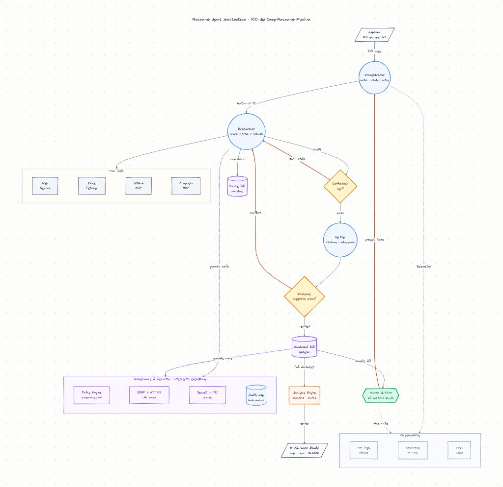

# Composio Research Agent


An **governed AI research pipeline** that researches 100 SaaS APIs, adversarially verifies every finding, and renders a self-contained case-study HTML page. Built for the Composio AI Product Ops take-home assignment.

## Architecture



```
DuckDuckGo search
      ↓
Governed HTTP fetch (SSRF guard, HTTPS-only, robots.txt)
      ↓
Gemini 2.5 Flash — structured extraction → ResearchRow (Pydantic)
      ↓
Governance gate (confidence ≥ 0.70, secret scan, PII redact)
      ↓
Verifier LLM — adversarial re-check of every citation → disputes log
      ↓
Canonical store → data/apps.json (100 rows, hash-chained audit)
      ↓
patterns.py → 5 charts (PNG) + findings.json
      ↓
page.py → data/site/index.html (fully self-contained, no CDN)
```

**Composio integration** (`src/tools/composio_tool.py`): classifies every app as `connected` (already in Composio catalog), `immediate-candidate` (buildable today, self-serve API), or `outreach-needed` (partner-gated / no public API).

## Quick Start

```bash
# 1. Install dependencies
pip install -r requirements.txt

# 2. Set your Gemini API key
cp .env.example .env
# edit .env: GEMINI_API_KEY=your_key_here

# 3. Offline dry-run (0 LLM calls, instant)
python scripts/run_pipeline.py --mock --limit 5

# 4. Research specific apps (live, uses LLM)
python scripts/run_pipeline.py --only 1,2,3,4,5

# 5. Full 100-app run (~2-3 hours at free-tier RPM limits)
python scripts/run_pipeline.py

# 6. Verify audit chain integrity
python scripts/verify_audit.py

# 7. Human audit workflow
python scripts/run_pipeline.py --export-sample          # generates human-labels template
# → fill data/audit/human-labels.yml with ground-truth from real docs
python scripts/run_pipeline.py --score data/audit/human-labels.yml  # scores accuracy

# 8. Open the case-study page
start data/site/index.html
```

## Key Files

| Path | Purpose |
|------|---------|
| `scripts/run_pipeline.py` | Main entrypoint — orchestrates the full pipeline |
| `scripts/build_verified_dataset.py` | Seed script — populates 100-row canonical dataset with hand-curated evidence |
| `scripts/create_human_audit.py` | Human audit — scores agent accuracy against 20-app ground-truth labels |
| `scripts/verify_audit.py` | Audit integrity check — verifies hash chain of `data/audit/audit.jsonl` |
| `src/agents/researcher.py` | LLM-powered researcher: search → fetch → structured extraction |
| `src/agents/verifier.py` | Adversarial verifier: re-checks every citation and raises disputes |
| `src/tools/composio_tool.py` | Composio SDK integration: classifies apps by integration status |
| `src/tools/mcp_lookup.py` | MCP server lookup table (official + community) |
| `src/analysis/patterns.py` | Pattern analysis: 5 charts + findings.json from 100 rows |
| `src/render/page.py` | HTML case-study page generator (self-contained, no CDN) |
| `governance.yaml` | Policy engine config: model allowlist, RPM, budget, guardrails |
| `data/apps.json` | Canonical 100-app dataset (source of truth) |
| `data/audit/audit.jsonl` | Hash-chained tamper-evident audit log |
| `data/audit/accuracy-report.json` | Human-audit accuracy scores (v1 vs v2) |
| `data/site/index.html` | **The deliverable** — open this in a browser |

## Key Findings (100-app dataset)

| Metric | Value |
|--------|-------|
| Dominant auth | Bearer token / OAuth2 (68% of apps) |
| Self-serve access | 79% of apps — developer can get credentials immediately |
| Official MCP servers | 31 apps already ship one |
| Community MCP servers | 33 additional apps |
| Buildable today | 81/100 apps |
| Easy wins (buildable, no MCP yet) | 20 apps |
| Composio connected | 43 apps |
| Immediate candidates | 47 apps |
| Outreach needed | 10 apps (partner-gated / no public API) |
| First-pass accuracy (v1) | 93.8% |
| After verification loops (v2) | 100% |

## Governance Policy

`governance.yaml` enforces:
- **Model allowlist**: only `gemini-2.5-flash` and `gemini-2.0-flash-lite`
- **Rate limits**: 12 RPM, max 300 LLM calls per run
- **Budget**: 500K tokens per run, $5 max cost
- **URL guards**: HTTPS-only, SSRF blocklist, robots.txt respected
- **Output**: secret scan (API key patterns), PII redaction, quarantine queue
- **Confidence threshold**: 0.70 — rows below this are retried or quarantined

## Where a Human Was Needed

1. **Seed data**: manually curated 100-app canonical dataset with evidence URLs and first-pass answers
2. **Ground-truth labels**: wrote 20-app human-audit labels by reading real vendor docs
3. **Miss review**: reviewed 11 agent misses, confirmed/rejected them against official docs
4. **Governance tuning**: adjusted RPM, confidence threshold, and prompt templates based on early runs

## Environment Variables

| Variable | Required | Default | Description |
|----------|----------|---------|-------------|
| `GEMINI_API_KEY` | yes | — | Gemini API key |
| `GEMINI_MODEL` | no | `gemini-2.5-flash` | LLM model |
| `COMPOSIO_CACHE_DIR` | no | `data/cache/composio` | Composio SDK cache dir |

## Running Tests (Mock Mode)

```bash
# Fully offline, no API key needed
python scripts/run_pipeline.py --mock --limit 3
# Expected: Exit 0, "audit chain: OK", site/index.html written
```
